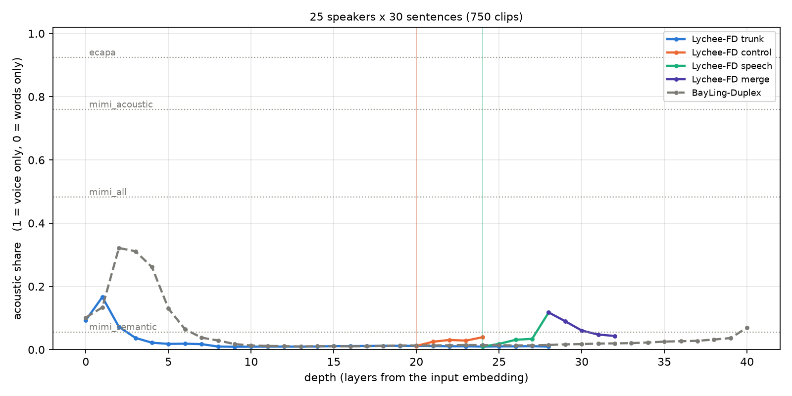
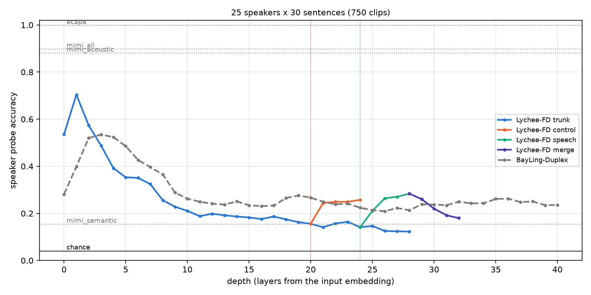
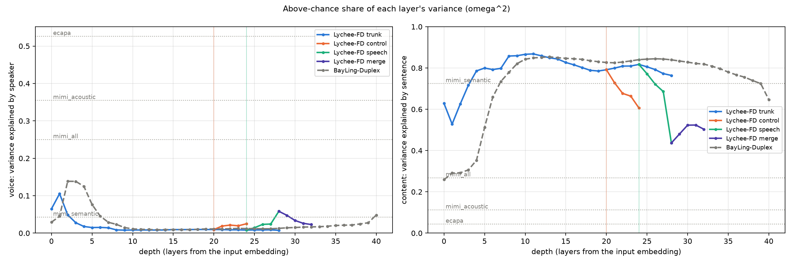
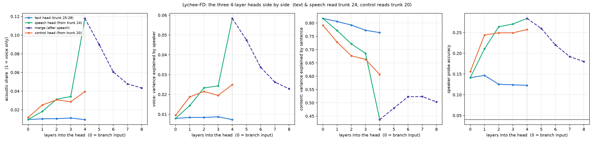
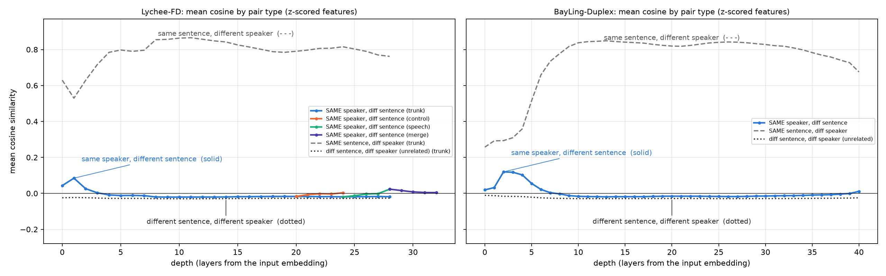

# Results: voice vs words across Lychee-FD and BayLing-Duplex

Run 2026-11-07. Data: 750 clips = 25 cloned voices x 30 Harvard sentences (complete grid).
Both models were fed in their listening state and scored with the same metrics, on the
same clips, against the same baselines. Raw numbers are in `results/lychee.json` and
`results/bayling.json`.

The `acoustic_share` here uses the corrected chance floor taken from the residual
variance (omega²). The first server run used a floor taken from the total variance; when
content explains ~80 % of a layer, that floor is about 5x too high and clipped real voice
variance to 0. `lyprobe/rescore.py` recomputed both files from their stored eta values,
which are exact, so no model run was needed.

## 1. How much of each layer is the voice

## 2. Can the speaker be read out

## 3. The two parts: voice variance and content variance

## 4. The three heads side by side

Each head on its own x-axis, from its branch input (0) through its 4 layers. Text and
speech both read trunk layer 24; control reads trunk layer 20. Merge continues after
speech at 5-8.

- **Text head** stays where the trunk left it: voice ~0.01, content 0.82 → 0.76, probe ~0.13.
- **Speech head** moves the other way: voice share rises at every layer (0.010 → 0.034,
  then 0.118 at layer 4), content falls 0.82 → 0.44, and the speaker probe doubles
  (0.14 → 0.28).
- **Control head** does the same thing, more mildly: voice 0.012 → 0.039, content
  0.79 → 0.61, probe 0.16 → 0.26.
- **Merge** reverses the speech head, pulling it back toward content as it adds the next
  text token's embedding.

All three heads start from nearly the same point (acoustic share ~0.01) and separate in
their own layers. This is the modality separation Lychee was designed for, visible in the
representations.

## 5. Cosine: same speaker, different sentence

Mean cosine between utterance-mean vectors (z-scored per dimension), for three kinds of
pairs: same speaker / different sentence (`s_spk`), different speaker / same sentence
(`s_txt`), and different speaker / different sentence (`s_none`, nothing shared). In
Lychee the same-speaker line is drawn once per path (trunk, control, speech, merge); the
bonus numbers below are `s_spk - s_none`.

- **The same sentence matters far more than the same voice.** Two different people saying
  the same sentence reach cosine 0.75-0.87 in the middle layers. One person saying two
  different sentences stays at about -0.02, almost the same as two unrelated clips (-0.03).
- **The voice bonus peaks early and then collapses.** Lychee trunk_1 gives +0.108 and
  BayLing layer 2 gives +0.136. By layer 4 Lychee is at +0.019, and BayLing reaches the
  same level by layer 9. After that both stay near +0.01.
- **The heads in Lychee:** control rises to +0.025 and speech_4 to +0.038, then merge drops
  back to +0.022. BayLing's last layers climb slightly, to +0.036 at layer 40.
- **For reference:** ECAPA gives +0.55 and Mimi CB2-8 +0.35. The best LLM layer reaches
  about a quarter of Mimi's acoustic codebooks.
- **Agreement with the other metrics:** the cosine view gives the same layer ranking as
  acoustic share and the probe, with the same peaks (Lychee 1, BayLing 2-4).
- **Raw-feature cosines** are kept in the JSON (`*_raw`) but not plotted. Raw hidden
  states share one dominant direction, so every pair sits at 0.75-1.0 and `s_spk` lies on
  top of `s_none`.

## Key numbers

| point | depth | acoustic share | voice var. | content var. | speaker probe |
|---|---|---|---|---|---|
| **Lychee trunk_1** (peak) | 1 | **0.166** | 0.105 | 0.528 | **0.704** |
| Lychee trunk_4 | 4 | 0.022 | 0.018 | 0.786 | 0.392 |
| Lychee trunk_20 (control branches here) | 20 | 0.012 | 0.010 | 0.791 | 0.156 |
| Lychee trunk_24 (speech branches here) | 24 | 0.010 | 0.008 | 0.817 | 0.141 |
| Lychee trunk_28 (text head) | 28 | 0.009 | 0.007 | 0.764 | 0.123 |
| Lychee control_4 (control head) | 24 | 0.039 | 0.025 | 0.606 | 0.257 |
| **Lychee speech_4** | 28 | **0.118** | 0.058 | 0.437 | 0.284 |
| Lychee merge_4 (speech head) | 32 | 0.043 | 0.023 | 0.503 | 0.180 |
| **BayLing layer 2** (peak) | 2 | **0.322** | 0.139 | 0.292 | 0.520 |
| BayLing layer 3 (best probe) | 3 | 0.311 | 0.138 | 0.306 | **0.535** |
| BayLing layer 20 | 20 | 0.013 | 0.011 | 0.826 | 0.267 |
| BayLing layer 40 | 40 | 0.070 | 0.048 | 0.646 | 0.236 |
| ECAPA | - | 0.924 | 0.526 | 0.043 | 0.997 |
| Mimi CB2-8 (acoustic) | - | 0.759 | 0.355 | 0.112 | 0.880 |
| Mimi CB1-8 | - | 0.482 | 0.250 | 0.268 | 0.897 |
| Mimi CB1 (semantic) | - | 0.055 | 0.043 | 0.724 | 0.153 |
| chance | | | | | 0.040 |

## Findings

1. **Words dominate both models almost everywhere.** From layer ~5 on, sentence identity
   explains 0.5-0.87 of the variance and speaker identity at most 0.06. The two models
   look alike in their middle layers.

2. **Lychee starts with more voice but loses it faster.**
   - Lychee's first block holds the most speaker-decodable representation of any LLM
     layer measured: probe 0.704 against BayLing's best of 0.535. Its input is continuous
     Whisper-encoder features, not discrete 175 bps semantic tokens.
   - By layer 4 that has fallen to 0.39, and by the end of the trunk to 0.12.
   - BayLing peaks later (layers 2-4) and keeps a residue near 0.24 to the end.

3. **The branches split off a trunk that has already discarded the voice.** At the
   branch points (layers 20 and 24) the acoustic share is ~0.01. The paper motivates
   the split with gradient conflict in deep layers; on the representation side, the
   voice is already marginal from layer 4.

4. **Both heads bring some voice back.**
   - Control branch: probe 0.156 → 0.257, content 0.79 → 0.61.
   - Speech branch: the strongest recovery, at speech_4 (share 0.118, content 0.44).
     The merge layers then lower it again (merge_4 share 0.043). They add the next text
     token's embedding, which pulls the representation back toward content.

5. **For the multi-speaker plan:**
   - On Lychee, a `<spk>` head or a Mimi injection belongs at **layers 1-2**, earlier
     than BayLing's 2-4. Nothing after layer 4 carries much of the user's voice.
   - Mimi CB2-8 (probe 0.880, share 0.76) remains far ahead of any layer of either model,
     so injecting it is still justified.

## Caveats

- **Lychee doesn't need the user's voice.** Its speech head synthesizes the assistant's
  own fixed voice, so losing the user's voice is no defect for Lychee itself. It only
  matters for a multi-speaker extension.
- **The speech and merge branches were measured outside their regime.** In the listening
  state they only ever see `stoken_pad`, not the speaking they were trained for.
- **Final-norm effect is untested.** The speech_4, control_4 and merge_4 points are each
  branch's last layer, which in transformers' Qwen2Model may come after that branch's
  final RMSNorm. Per-dimension z-scoring removes global scale but not per-token norm
  effects, so part of the speech_4 bump may be the norm. This was not tested.
- **The labels are narrow.** "Voice" means speaker identity and "words" means sentence
  identity. The clips are TTS-cloned voices and utterance-mean pooled.
- **The probes show decodability, not use.** Only injection experiments show what the
  model actually uses.
